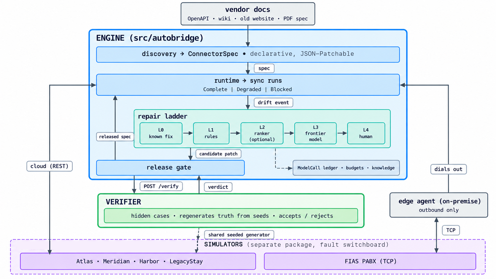

# AutoBridge

Generic Connect + Heal engine: compiles declarative connectors from vendor docs, executes
them on a schedule, detects drift when a vendor changes, repairs the connector through a
deterministic-first ladder (L0 knowledge → L1 rules → L2 small model → L3 frontier model →
L4 human), and verifies every repair behind a separate trust boundary before it ships.

Money is `Decimal` end to end; dates are property-local business dates; every `SyncRun`
ends `Complete | Degraded | Blocked` with the unmet criterion named.

## Quickstart (clean machine: Docker + `uv` + Node 22/`npm` for the UI)

```bash
cp .env.example .env        # demo defaults run as-is; add FRONTIER_API_KEY for live L2/L3 (.env is git-ignored)
make ui-deps                # one-time UI install (`cd ui && npm ci`; also auto-run by `make test`/`make e2e-ui`)
make edge-sign               # pin the edge command bundle (required once you set EDGE_RELEASE_SECRET; harmless otherwise)
make up                     # build images, start the stack, wait for every /readyz
make smoke                  # healthz/readyz + trust-boundary network probes
make test                   # unit, ≥90% coverage per Python package
make e2e                    # every pytest file in tests/e2e, random order
make e2e-ui                 # Playwright UI journey (needs `make up` first)
make bench                  # dev ablation + learning curve; scorecard from the ablation (calls models)
make demo                   # eight demo steps through the control API (plan §6)
make down                   # docker compose down -v
```

With the stack up, each simulated vendor has its own documentation site, rendered live from the files
AutoBridge reads in `simulators/docs/`:

| Vendor | Docs site | Source |
|---|---|---|
| AtlasPMS (method-style REST: getReservations/getReservation/getGuest/getHotels/getTransactions, x-api-key auth, pageNumber/pageSize, JSON-number money) | http://localhost:8105/developers | `atlas-openapi.yaml` |
| HarborPMS (messy wiki) | http://localhost:8106/developers | `harbor.md` |
| LegacyStay (2000s website) | http://localhost:8111/developers | `legacystay.md` |
| MeridianPMS (POST/JSON: body-field auth, Limitation cursor, UTC instants; names via customers, money via order items) | http://localhost:8116/developers | `meridian-openapi.yaml` |
| FIAS PABX (on-premise exchange over TCP: STX/ETX framing, link handshake, PS postings answered with PA; viewed as an uploaded document) | http://localhost:8118/developers | `fias-pabx.md` |

The full gate order from a clean clone is
`make test → make up → make smoke → make e2e → make e2e-ui → make demo`.
Run it locally; the GitHub Actions workflow (`.github/workflows/ci.yml`)
is in the repo but switched off.

`make bench` runs the dev ablation + learning curve and writes the
scorecard from the ablation results (the synthetic matched mode stays
behind `--arms matched` for harness tests). It calls models (provider
keys needed; costs money). See `docs/benchmark.md`.

## No Docker (plain laptop: Python 3.12 + `uv`, Node 22/`npm`)

Someone who downloads the repo may have no Docker and no sandbox. The same
stack runs as local processes on the same host ports (control 8101 …
UI 8107):

```bash
cp .env.example .env        # demo defaults run as-is; add FRONTIER_API_KEY for live L2/L3 (.env is git-ignored)
make edge-sign               # pin the edge command bundle (required once you set EDGE_RELEASE_SECRET; harmless otherwise)
make local-up               # start every service locally, wait for every /readyz
open http://localhost:8107  # the UI (same-origin /api rewrite → control :8101)
make demo                   # eight demo steps through the control API (plan §6)
make smoke                  # healthz/readyz green; Docker network probes report "skipped: local mode"
make e2e                    # live tests run against the local stack too
make local-down             # stop everything (data kept in ./.local/autobridge.db)
```

Prerequisites: Python 3.12, [`uv`](https://docs.astral.sh/uv/),
Node 22 + npm (UI only — the stack starts without it, with a warning).
Works on macOS and Linux; on Windows use WSL2 (process control and
loopback ports behave the same there; native `cmd`/PowerShell is not
supported). SQLite lives in `./.local/autobridge.db`, logs in
`./.local/logs/`, PIDs in `./.local/pids/` (all git-ignored).

Local mode executes specs in-process (`LocalProcessTarget` even when a spec
declares `docker_sandbox`) and says so: every `/readyz` carries
`runtime_mode: local` + `network_isolation: "local mode: no network
isolation"`, and the UI header shows a LOCAL badge. Docker network
separation is the one thing local mode cannot enforce — see
`docs/safety-model.md` §12. Never expose a local stack beyond localhost
with real credentials. To force or forbid it explicitly:
`AUTOBRIDGE_RUNTIME=local|docker` (default: local when Docker is
unavailable, docker otherwise).

## How to run the demo (recording script, ~10 minutes)

Terminal on the right, browser on the left (`http://localhost:8107`).
The presenter runs one command per scenario; the UI reacts by itself —
**every state change stays visible, and the presenter clicks every
approval** (repairs never auto-apply).

```bash
make local-up                  # or: make up (Docker). Wait for "all services readyz green"
make demo-reset && make demo-seed
```

`make demo-seed` ends on "0 connectors · ready to build" and
`http://localhost:8107` opens on the empty Connectors page — every simulator up on its baseline
scenario, nothing built, nothing learned (`make demo-seed` fails loud
otherwise). Every connector below is built live from its docs.
Each block is one command, then watch (deck order, `docs/demo.md`):

- **Deck 1 — What AutoBridge knows.** Open `/knowledge` (top bar): each
  vocabulary row reads "no connector built on it yet", the right-hand
  column reads "Nothing learned yet", Decisions reads "No operator
  decisions yet". On `/connectors` the header reads "0 connectors" and
  the empty state leads with **"Build a connector"**.
- **Deck 2 — Build Atlas from its OpenAPI.** Open `/connectors/new`,
  pick the Atlas docs, keep vocabulary v1 and **Start build**: release r1,
  first sync Complete, AtlasPMS ● Working with 0 model calls.
  `/knowledge` lists AtlasPMS under v1.
- **Deck 3 — Zero-token fix.** `make demo-break SCENARIO=page_to_cursor` →
  AtlasPMS turns ▲ Degrading ("fix ready · verified · 0 model calls");
  a repair appears at the top of `/repairs` **without reloading** as
  "fix ready" with "0 model calls". Open it: the page answers what happened,
  what the engine did, what it decided, and what Approve does — then
  click **Approve release** and watch the connector return to ● Working
  (approval → release → verifying sync → Complete). On the connector
  page, Releases → **Activate** r1, then run the break again:
  the same drift now resolves at L0 and the Knowledge entry reads
  "reused 1×".
- **Deck 4 — Build Harbor from its wiki.** Open
  `/connectors/new`, pick the Harbor docs, **Start build**, watch docs read → docs check →
  draft → probes → result → release — including the line "check added from the
  docs: totals must match `meta.gross_sum`". The new connector's page
  shows its spec (with the totals check), releases and sync runs,
  ● Working. Deck 6 below builds Meridian the same way (v1 first).
- **Deck 5 — Break Harbor right after.** `make demo-break
  SCENARIO=gross_to_net TARGET=harbor` → the scheduled sync Degrades on
  `money_invariant` (the wiki-built release carries the check):
  HarborPMS turns ▲ Degrading, then ■ Error with "needs your decision".
  Open the new `/repairs` row (`SEMANTIC_VALUE_DRIFT`, escalate): the
  top box leads with the model's question and its rationale, plus the
  one proposed change when the model offered it. Click
  **Approve: \<the model's label\>** ("accept net") and watch Harbor
  return to ● Working (release r2 from the proposal, verifying sync,
  recorded as a business decision — not a verified fix, and never
  learned); or **Deny: keep everything as-is, contact the vendor**
  and watch it stay ■ Error, denied, waiting on the vendor — Deny sticks:
  re-detections of the same drift attach to the denied repair (no new
  repair, no new model call). The instrumented step-4 climb in
  `make demo` runs the same inputs for the printed derivation; it is
  recorded as a second row only when the break's L3 was skipped.
- **Deck 6 — New kind of API.** Open `/connectors/new`, pick the Meridian
  docs, keep vocabulary v1 and **Start build**: the build is refused on screen
  with the engine's named reason (POST with a JSON body and body-field
  auth are not expressible in ConnectorSpec v1) — no release, 0 model
  calls, and the attempt stays recorded. **Download capability request**
  drafts the gap as a Markdown file shaped for the build loop (no model
  used). Click **Build with v2**:
  release r1, first sync Complete, MeridianPMS ● Working. The connector
  page shows both attempts (v1 refused with its reason, v2 in use) and
  the result carries the engine's runtime decision ("runs: cloud").
- **Deck 7 — On-premise PABX.** Open `/connectors/new`, pick the FIAS PABX
  docs: there is no base URL to type and no runtime to choose — the
  relay address is fixed and vocabulary v3 is suggested, because the
  engine runs framed docs on the on-premise edge agent (the result says
  "runs: on-premise edge agent, via the relay"). Pick v2 and **Start build** first:
  refused on screen (event-driven feeds are not expressible in
  ConnectorSpec v2), 0 model calls, attempt recorded — then
  **Build with v3**: release r1,
  the edge agent connects, postings flow, PABX edge ● Working.
  `/knowledge` lists it under v3 with v2 refused. Then
  `make demo-break SCENARIO=fias_link_resync` → the PABX panel shows the
  link go down, the agent re-handshakes (LS/LD/LR/LA), the link comes
  back — the relay log still holds every pre-break posting exactly once
  (nothing lost, nothing duplicated) — and the connector stays ● Working.
  No repair, no Approve.
- **Deck 8 — Proof.** `make demo` (terminal-only, 8 steps) drives the same
  story through the control API and checks each step's evidence. Without
  `FRONTIER_API_KEY` its L3 legs are labelled skips. Known issue: with a
  live key, step 4's post-approve check fails (it expects the repair's
  decision to still read `escalate`; approving records `approved`).
  No benchmark results are committed: the final benchmark is the beacon
  run (`docs/benchmark.md`, "Beacon evaluation"), which has only been
  rehearsed so far.

Retakes: `make demo-heal` clears injected faults without a reset;
`make demo-reset && make demo-seed` restores the blank opening frame
(0 connectors, every simulator on baseline).
Settings: `AUTOBRIDGE_SYNC_INTERVAL_S` (default 10; the scheduler syncs
every connector each tick and never approves); `FRONTIER_API_KEY` —
with a key the semantic climb calls Muse live; without it the step
replays a capture from `demo/recordings/` when one exists (none is
committed) and otherwise records an explicit, labelled L3 skip.

## How it works

1. **Connect** — a vendor's docs become a declarative `ConnectorSpec` (YAML/JSON) via
   bootstrap (docs → hypotheses → probes → evidence → spec), or start from a reference
   spec under `generated/connectors/<id>/reference/`.
2. **Execute** — the runtime interprets the spec (`GET` operations in v1, POST/JSON
   bodies in v2, framed TCP event feeds in v3 via the edge agent; auth by
   `credential_ref`, pagination with guards, closed transform set, per-entity checks)
   and records a `SyncRun` with outcome, `data_readiness`, `fingerprint_id` and
   checkpoint. Baseline syncs use zero model calls.
3. **Detect** — fingerprint + classifier assign one of 12 drift classes
   (`SCHEMA_RENAME`, `PAGINATION_CHANGE`, `SEMANTIC_VALUE_DRIFT`, …).
4. **Repair** — the ladder tries L0 knowledge, then 9 deterministic L1 rules
   (JSON Patch on the spec), then budgeted L2/L3 model calls, else escalates with a
   bundle (exactly one question + redacted evidence). Known patterns repair with
   `frontier_tokens == 0`.
5. **Verify** — the separate verifier service (own package, image, network) runs the
   oracle + canonical checks in visible or hidden mode and returns only bounded
   `failed_checks` names/counts + score — never fixture rows. A regression gate
   re-runs previously verified scenarios before a release persists; the
   intentionally-wrong patch (`invalid_patch_trap`) is always rejected.
6. **Ship** — approve / reject / rollback releases; canary monitor + consumer
   pause/notify (`DependencyRegistration`) on `release.activated`.

Design principles (plan §1): repairs are data (JSON Patch, no generated code);
three trust boundaries (`src/autobridge`, `verifier/`, `simulators/` — separate
packages, images, Docker networks; the engine never imports or reads the other two);
deterministic first; success is a typed outcome, not a 200; coverage ≥ 90% per
package; every service has `/healthz` + `/readyz`; secrets only as `credential_ref`.

## Models

AutoBridge uses Meta Muse models in two separate roles.

**Inside the product.** The repair ladder's L2/L3 steps and every benchmark arm call
Meta's Muse Model API (`https://api.meta.ai/v1`, OpenAI-compatible). The model is set by
`FRONTIER_MODEL` (default `muse-spark-1.3`; `muse-spark-1.3-contributor` and
`muse-wonder-1.0` are the other ids in `src/autobridge/config.py`); L2 uses `SMALL_MODEL`,
which defaults to the same model. The beacon benchmark pins `muse-spark-1.3-contributor`
for all arms. Without `FRONTIER_API_KEY` the engine makes no model call: it replays a
recording or records the skip. No weights are bundled; nothing runs locally.

**Writing the code.** The autonomous loop (`ralph-afk.sh`) ran OpenCode on Muse Spark Open
(open weights, served on Baseten as `muse-spark-open-1026` and on Modal as
`Muse-Spark-Open-816B-A42B`), on Muse Spark 1.3 through the Meta API, and on Muse Wonder 1.0
for review loops. Each commit's `Co-Authored-By` trailer names the model that wrote it:
`git log --format='%(trailers:key=Co-Authored-By,valueonly)' | sort | uniq -c` gives the counts.

## Layout

```
autobridge/
├── README.md  compose.yaml  .env.example  Makefile  pyproject.toml (uv workspace)  ralph-afk.sh
├── docs/            architecture.md  connector-spec.md  safety-model.md  benchmark.md  demo.md
├── schemas/         reservation / folio-charge / connector-spec.v1-v3 / runtime-target / discovery-result.v0
├── src/autobridge/  spec/ runtime/ discovery/ drift/ repair/ llm/ evidence/ control/ engine/ edge/ bench/
├── bench/           harness, ablation arms, demo / demo-seed / demo-break / demo-heal drivers, beacon run
├── config/          demo targets, ablation cases, beacon vendors, prompts
├── verifier/        own pyproject; oracle, canonical checks, hidden_cases/{dev,heldout}
├── simulators/      own pyproject; common/ atlaspms/ harborpms/ legacystay/ meridianpms/ fias_pabx/ edgepos/ devportal/ docs/ scenarios/ (27 YAMLs)
├── generated/       connectors/<id>/reference/spec.yaml + build-report.json (committed reference specs)
├── ui/              Next.js 15 + TypeScript + Tailwind; lib/api (openapi-typescript client)
├── experiments/     preregistration.md  learning_curve.md  benchmark_runs/ (run output, not committed)
├── mcp_stretch/     Phase 2
├── tests/           unit/  e2e/ (pytest suite + Playwright *.spec.ts journeys)
├── scripts/         local-up.sh  local-down.sh  wait_readyz.sh  smoke.sh  edge-sign.sh  beacon-eval.sh  …
├── mds/             planning + agent bookkeeping (plan, PRD index, tracking, notes, directives)
└── alembic/         migrations for the core data model
```

## Docs

| Page | Covers |
|---|---|
| `docs/architecture.md` | Services, networks, health contracts, data model, ladder, e2e harness, control API + UI |
| `docs/connector-spec.md` | ConnectorSpec v1/v2/v3 reference: source/auth, operations, pagination, entities, closed transforms, checks, JSON Patch |
| `docs/safety-model.md` | Verifier trust boundary, oracle, scenario catalog, semantic invariants, regression gate, escalation, guarantees |
| `docs/benchmark.md` | Matched-budget harness, baseline drivers, ablation arms, scoring, `make bench` pipeline, beacon evaluation (the final benchmark) |
| `docs/demo.md` | Eight demo steps (plan §6) through the control API, with the evidence each step renders |

## Technical Architecture


## The autonomous loop

```
cp .env.example .env                       # SLACK_WEBHOOK, provider keys, model ids
sh ralph-afk.sh sbx1 10                    # default: OpenCode on Meta (RALPH_AGENT / RALPH_PROVIDER)
sh ralph-afk.sh --agent claude sbx1 10     # Claude Code only
sh ralph-afk.sh --agent opencode --provider meta --model muse-wonder-1.0 sbx-mini 5
sh ralph-afk.sh --validate sbx-mini 1      # daily directives audit
```

Ralph (planning, iterations, checkpoints, validation) drives one coding-agent runtime for
the whole run: Claude Code in its own sandbox, or OpenCode in its own sandbox on one
provider (Baseten Spark Open, Modal Spark Open, or Meta Spark 1.3 / Contributor / Wonder).
There is no fallback: an auth, credit, provider or empty-run failure stops the loop. The verification gates
(`make lint / typecheck / test`, the workstream's e2e file, the mds/ bookkeeping) are the
same whichever runtime ran. Setup and the provider table: `mds/DEPLOY.md`.

Prerequisites before the first run: `git init` + a GitHub `origin` with a `main` branch
(the loop works in `.worktrees/<sbx>` off `origin/main` and pushes there),
`gh auth login`, Docker Sandboxes (`sbx`) with the four sandboxes named in `mds/DEPLOY.md`,
Claude signed in inside `claude-autobridge`, network policy allowing the three provider
hosts.

## mds/ files

| File | Role | Who reads it |
|---|---|---|
| `AutoBridge_Implementation_Plan_2026-10-26.md` | The plan (design + build order). Stable. | Agents, one § at a time |
| `PRD.MD` | Index into the plan; owner-only decisions log | Agents, by § |
| `PRD-TRACKING.md` | Task manifest (`[ ] [>] [~] [x]`) — pick and claim work here | Every loop iteration |
| `BUILD-NOTES.md` | Per-task build notes, keyed by task id | On demand |
| `progress-state.md` / `progress-log.md` | Current state (≤4 KB, in every prompt) / append-only history | Every iteration / on demand |
| `DIRECTIVES.MD` (+ `-INSTRUCTIONS`) | Rules; Quick Reference is in every prompt, § sections via `./directives-for.sh` | Every iteration |
| `LEARNINGS.MD` (+ `-INSTRUCTIONS`) | Non-obvious things that bit us | Before writing a learning |
| `REQUESTS.MD` (+ `-INSTRUCTIONS`) | Owner requests and bugs, open section in every prompt | Every iteration |
| `FEEDBACKS.MD` (+ `-INSTRUCTIONS`) | Review verdicts (security / code / product) | Every iteration (verdicts only) |
| `AUDIT.md` | Last directives audit marker + findings | `--validate` runs |
| `DEPLOY.md` | Runbook (clean-clone check, demo recording) | Owner |
